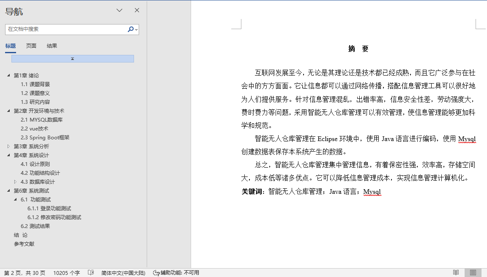
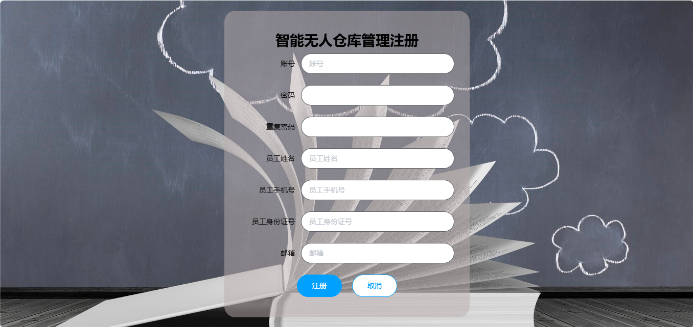
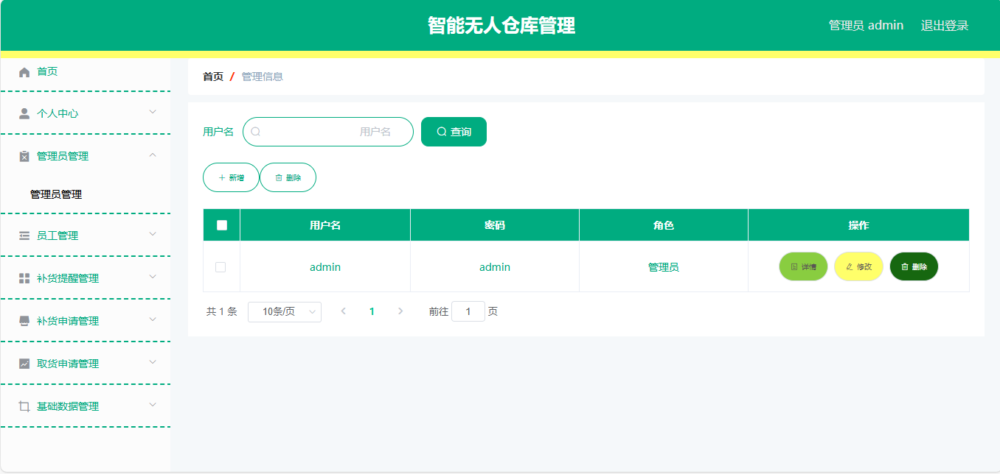
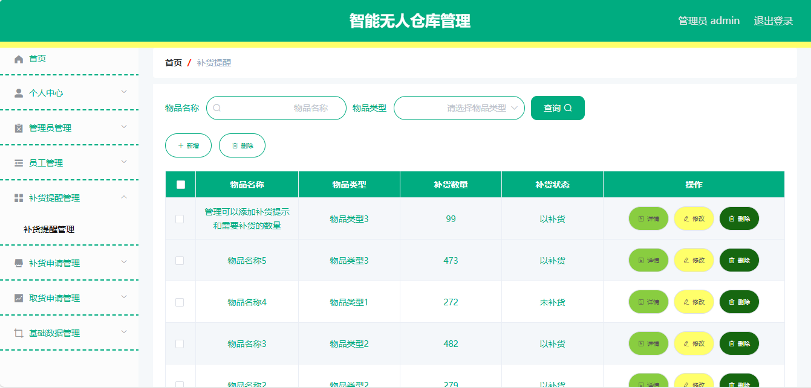
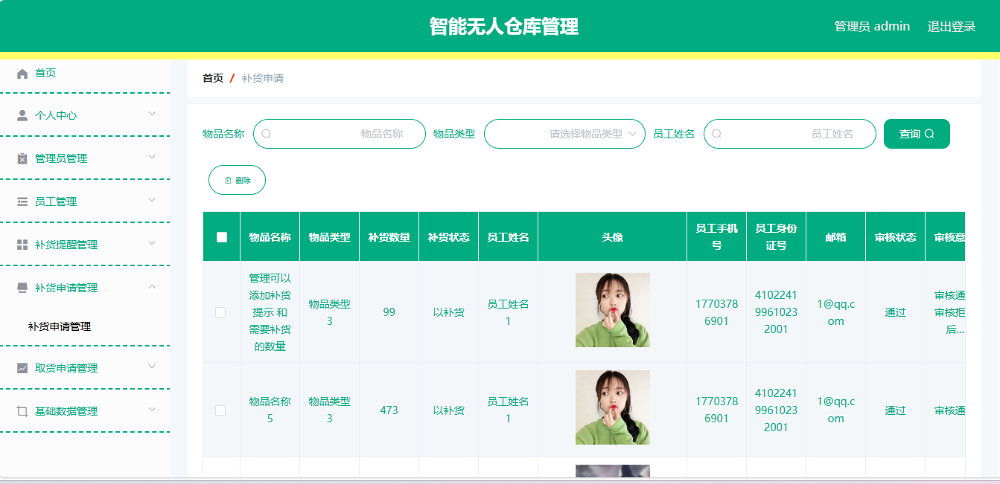
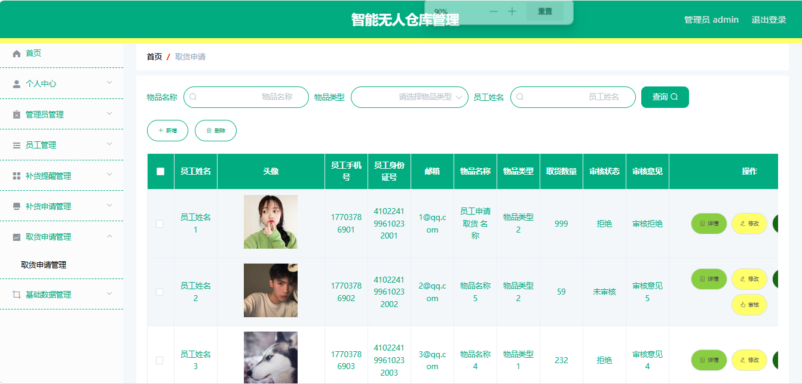
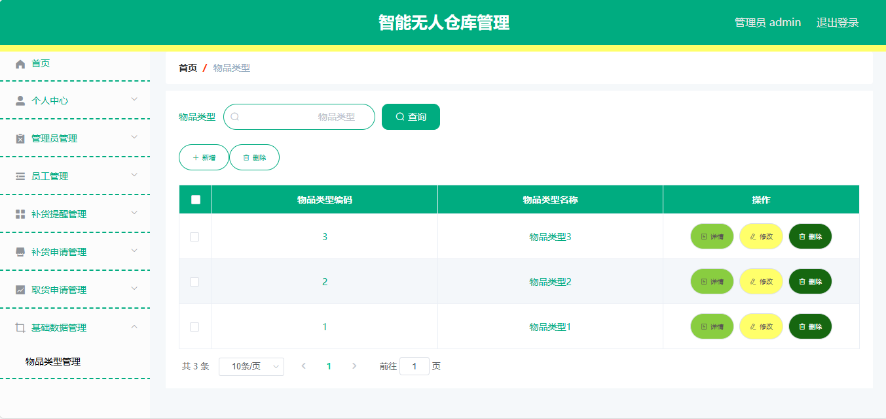
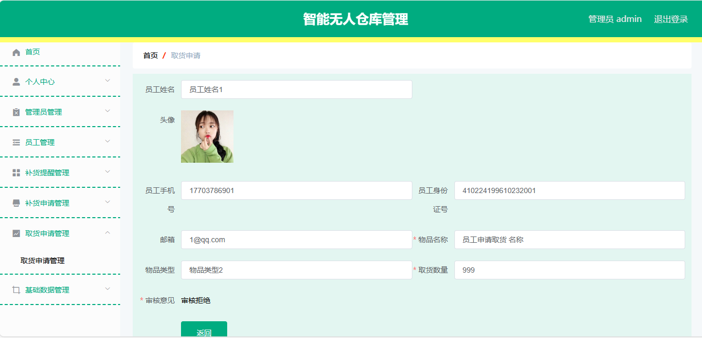
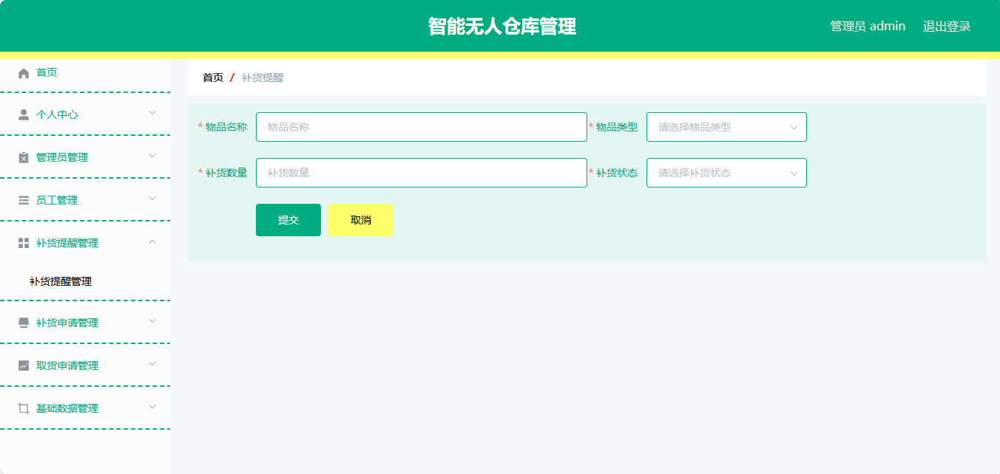
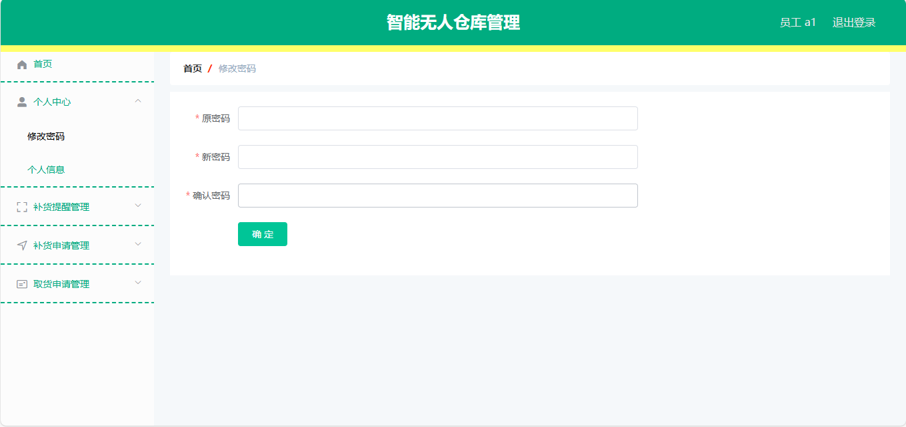

## 基于SpringBoot+vue的智能无人仓库管理系统(程序+报告)

###  获取完整源码和sql数据库文件（完全免费）: 微信: littlepinia88 程序员蛙哥
###  所有项目以及源代码本人均调试运行无问题 可支持远程安装部署调试、定制修改、代码讲解

## 项目介绍

本项目是一个基于 Spring Boot + MyBatis-Plus 的智能无人仓库管理系统，面向自助式仓储取还货场景，采用「Vue + Element UI 管理端 + Spring Boot 后端」前后端分离架构，打通了库存提醒登记、用户提交补货申请、管理员审核补货、用户提交取货申请并跟踪状态的业务闭环。后端提供 RESTful JSON 接口，前端为 vue-cli 单页应用，可作为课程设计、毕业设计或仓储类管理系统的入门实践案例。

### 系统角色
- **管理员**：通过 `users` 登录后台，维护补货提醒项、审核补货/取货申请、管理用户账户。
- **用户（仓库使用人）**：通过 `yonghu` 注册登录，提交补货申请与取货申请，并跟踪审核状态。
- **权限控制**：由 `AuthorizationInterceptor` 基于请求头 `Token` 鉴权，登录成功后签发 Token 写入 `token` 表；登录、字典分页与文件上传放行，其余接口无有效 Token 返回 401。

### 用户端功能
1. **注册与登录**：通过 `/yonghu/register` 注册、`/yonghu/login` 登录，支持重置密码、查看会话与退出。
2. **补货申请**：就某条补货提醒提交申请，关联 `buhuotixing_id` 与本人 `yonghu_id`，由管理员按 `buhuoshneqing_yesno_types` 审核。
3. **取货申请**：填写取货名称 `quhuoshenqing_name`、取货数量 `quhuoshenqing_number` 并提交，跟踪 `quhuoshenqing_yesno_types` 审核结果。

### 管理端功能
1. **补货提醒管理**：维护提醒项名称 `buhuotixing_name`、类型 `buhuotixing_types`、数量 `buhuotixing_number` 与库存状态 `buhuotixing_stauts_types`，支持分页、增删改与批量插入。
2. **补货申请审核**：查看用户提交的补货申请，按审核状态 `buhuoshneqing_yesno_types` 标记处理结果，并以 `buhuoshneqing_yesno_text` 填写审核意见。
3. **取货申请审核**：查看用户取货申请，按 `quhuoshenqing_yesno_types` 完成审核并填写意见。
4. **用户管理**：维护用户姓名 `yonghu_name`、头像 `yonghu_photo`、手机号 `yonghu_phone`、身份证号 `yonghu_id_number`、邮箱与性别 `sex_types`。
5. **数据字典与文件管理**：维护下拉枚举 `dictionary`、系统配置 `config`，以及文件上传 `/file/upload` 与下载。

### 技术栈
- **后端框架**：Spring Boot 2.2.2.RELEASE、Spring MVC、MyBatis-Plus 2.3（mybatis-spring-boot-starter 2.1.1）
- **数据访问**：MySQL（库 `a003_wurenchangku`），MyBatis-Plus 注解 + XML Mapper（`classpath*:mapper/*.xml`）
- **前端**：Vue 2.6 + Element UI 2.13 + vue-router + axios + ECharts
- **工程能力**：`AuthorizationInterceptor` Token 鉴权、`@IgnoreAuth` 放行、POI Excel、Hutool、FastJson、统一跨域响应头
- **构建运行**：Maven 打包可执行 jar；前端 dev server 端口 8081 代理到后端 8080

### 核心数据表
- `users` 管理员表：`username`、`password`、`role`
- `yonghu` 用户表：`username`、`password`、`yonghu_name`、`yonghu_phone`、`yonghu_id_number`、`sex_types`、`yonghu_delete`
- `buhuotixing` 补货提醒表：`buhuotixing_name`、`buhuotixing_types`、`buhuotixing_number`、`buhuotixing_stauts_types`
- `buhuoshneqing` 补货申请表：`buhuotixing_id`、`yonghu_id`、`buhuoshneqing_yesno_types`、`buhuoshneqing_yesno_text`
- `quhuoshenqing` 取货申请表：`quhuoshenqing_name`、`buhuotixing_types`、`yonghu_id`、`quhuoshenqing_number`、`quhuoshenqing_yesno_types`
- `dictionary` 字典表：`dic_code`、`dic_name`、`index_name`、`super_id`
- `config` 系统配置表：`name`、`value`

### 工程结构
```
A003wurenchangku
├── src/main/java/com
│   ├── controller/      REST 控制器（补货提醒、补货申请、取货申请、用户、管理员）
│   ├── service/         业务接口与 impl 实现
│   ├── dao/             MyBatis-Plus Mapper 接口
│   ├── entity/          实体类（含 TokenEntity）
│   ├── interceptor/     AuthorizationInterceptor Token 鉴权
│   ├── config/          拦截器注册、MyBatis-Plus 配置
│   ├── annotation/      @IgnoreAuth 放行注解
│   └── utils/           R 响应封装、文件等工具
├── src/main/resources
│   ├── application.yml   端口 8080、上下文 /wurenchangku、数据源
│   ├── mapper/          MyBatis XML 映射
│   ├── static/upload/    上传文件目录
│   └── admin/admin/      Vue 管理端工程（src 源码 + dist 打包产物）
└── pom.xml
```

### 访问入口
- 后端接口：`http://localhost:8080/wurenchangku/`（如 `/users/login`、`/yonghu/page`）
- 前端开发调试：`http://localhost:8081/`（vue.config.js devServer，代理 `/wurenchangku` 到 8080）

### 补充说明
- 数据库账号密码默认为 root/123456，首次运行需先创建并导入 `a003_wurenchangku` 库结构。
- 鉴权为自研 Token 机制，密码以明文形式入库，仅适合教学演示；二次上线时需替换为加密存储并接入成熟安全框架。
- 审核状态字段（`*_yesno_types`）为字典枚举值，具体文案由 `dictionary` 表动态维护。

## 运行环境
- JDK版本：JDK1.8及以上
- 开发工具：IDEA、Ecplise、Myecplise都可以
- 数据库: MySQL5.7及以上
- Node：14.14.0及以上

## 运行截图



















